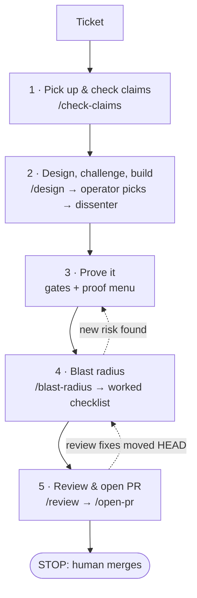

# agentic-workflow

[](https://github.com/J0r33/agentic-workflow/actions/workflows/gate-selftest.yml)
[](https://github.com/J0r33/agentic-workflow/actions/workflows/secret-scan.yml)
[](LICENSE)

A per-ticket workflow for building production software with AI coding agents while a human stays
accountable for what ships. It is a set of [Claude Code](https://docs.claude.com/en/docs/claude-code)
commands, subagent definitions, a project contract, and CI gate templates.

I use it to run a live booking, membership and payments platform: several agents work in
parallel, and I review and merge. The files here are the generic version, with nothing from that
client's code.

## The idea in one paragraph

Agents are fast and confident, and they are wrong in ways that look right. So every ticket goes
through five fixed steps, each meant to catch a different kind of wrong: a ticket that misdescribes
the code, a plan that sounds right and isn't, a change that passes tests but doesn't work, a change
that works but breaks something next to it, and a review that just agrees with the author. Then the
agent opens a pull request and **stops**. Merging, approving gates, and testing against live systems
stay with a person.

## How a ticket flows



| Beat | Command | What it catches | Ends with |
| -- | -- | -- | -- |
| 1. Pick up & check claims | `/beat-1` | A ticket that is wrong about the code | Every claim in the ticket marked verified, false, stale or unverifiable, with evidence |
| 2. Design, challenge, build | `/beat-2` | A plan that sounds right and isn't | 1–3 designs, the operator's choice, a dissenter's attack answered, small commits |
| 3. Prove it | `/beat-3` | "Tests pass" standing in for "it works" | Local gates, plus proof from a fixed menu keyed to which files changed |
| 4. Blast radius | `/beat-4` | Breaking something next to the change | A worked checklist, tied to the commit it traced |
| 5. Review & open PR | `/beat-5` | Review that just agrees with the author | Every finding fixed or refuted, a draft PR, and a stop |

Releases go out in waves. Several tickets land on `dev`, the wave is promoted to `staging` for QA,
then to `main`. `/wave-sweep` closes out a wave: it collects the follow-ups agents left in PR bodies
before the tickets auto-close and the follow-ups disappear.

## See it run

- **[One ticket, start to finish](docs/example-run.md).** A real payments bug from the platform this
  runs, followed through all five beats: reproduced first, tests red before the fix, a six-judge
  review with its disagreements answered in writing, a blast-radius trace tied to a commit, 22 CI
  checks, and two checks left to the operator.
- **The gates check themselves.** On every push, [`gate-selftest`](.github/workflows/gate-selftest.yml)
  runs each gate template against [fixtures](tests/gates/) with known answers: 3 that must pass and
  11 that must fail, each for a stated reason. If a gate stops going red, the self-test does.
- **This repo uses its own gates.** Pull requests here run the PR quality gate and gitleaks.
- **[See them fail](https://github.com/J0r33/agentic-workflow/pull/3).** A planted bad change: a
  hardcoded token-shaped string, and a PR that skips its blast radius. gitleaks flags the token
  (`square-access-token`, line 5), and the quality gate lists all seven things the PR is missing.
  The PR was closed unmerged, and its check logs stay readable.

## Why each gate exists

The short version is below. [`docs/gates.md`](docs/gates.md) has the full table.

- **Check claims first.** Tickets are written from memory, and line numbers go stale.
- **The operator picks the design.** Choosing between options is a business decision, so it should
  be visible.
- **A dissenter attacks every design and every diff.** Its only job is to disagree. Don't tell it
  what you think is wrong: a reviewer handed a hypothesis tends to return it confirmed.
- **Proof comes from a fixed menu, not judgement.** A migration, a CI job and a screen each need
  different proof, and the menu says which.
- **The blast-radius trace is tied to a commit.** Review fixes land after the trace. If HEAD moved,
  the trace is stale and gets re-run.
- **A human merges, by hand.** Backed by a deny rule in `.claude/settings.json`, though the rule is
  only a backstop.
- **CI gates fail closed.** A check that reports success while checking nothing is worse than no
  check, because its green result stops people looking. Each template refuses to pass when it could
  not run or examined nothing. Each was shown failing on purpose before it was trusted, and its
  failing cases are listed in its comments.

## What's in the repo

```
AGENTS.md                      project contract: human-only gates, five beats, proof, fail-closed rules
CLAUDE.md                      imports AGENTS.md for Claude Code
.claude/
  settings.json                deny rules: no merge, no force-push, no push to protected branches, no git stash
  commands/
    beat-1.md … beat-5.md      the five beats; each one runs its commands in full
    check-claims.md            verify every claim in a ticket
    design.md                  parallel research → 1–3 options → operator decides
    blast-radius.md            trace what a change could break → checklist
    review.md                  senior reviewer + dissenter, wider on sensitive surfaces
    open-pr.md                 preconditions, build, template, draft PR, stop
    wave-sweep.md              close out a release wave
  agents/                      claim-checker, codebase-mapper, pattern-finder, docs-checker,
                               dissenter, senior-reviewer, security-reviewer,
                               completeness-reviewer, blast-radius-tracer
docs/
  gates.md                     why each gate exists
  ticket-checklist.md          the five beats as a one-page checklist
  review-prompts.md            the reviewer roles as paste-anywhere prompts
  example-run.md               one real ticket through all five beats
templates/                     copy into your project
  .github/PULL_REQUEST_TEMPLATE.md
  .github/workflows/           typecheck, secret-scan (gitleaks), dependency-audit, pr-quality-gate
  scripts/                     audit-gate.mjs, pr-quality-gate.mjs (no dependencies)
tests/gates/                   pass and fail fixtures for every gate, and the runner CI uses
```

## Using it

1. Copy `AGENTS.md`, `CLAUDE.md` and `.claude/` into your project. Fill in the placeholders in
   `AGENTS.md` (your product and your sensitive surfaces).
2. Copy `templates/.github/` to `.github/` and `templates/scripts/` to `scripts/`. Set `TSCONFIG` in
   `typecheck.yml` to the tsconfig that actually includes your source.
3. Run one gate against your current tree before relying on it. Confirm it is green today, and that
   it goes red when you break what it guards.
4. Start a ticket with `/beat-1 <TICKET-ID>`.

The commands assume pnpm, a `dev → staging → main` branch flow, and an issue tracker with ticket
ids. Adjust the names; the structure is the point.

## Credit and license

This workflow started as my adaptation of an internal engineering workflow I used on an earlier
team, and I want to credit the people who built it. Several of its central ideas come from there: a
mandatory blast-radius check before a PR, a pre-PR gate command, a design step that produces options
before any code, and panels of specialised review agents. That workflow is proprietary, and **none
of its text is reproduced here.** Every command, agent definition and template in this repo was
written fresh, or developed by me while using the workflow on client work. The five-beat structure,
the proof menu, the human-only gates, the fail-closed gate rules and the wave sweep are my
additions.

Released under the [MIT License](LICENSE).
